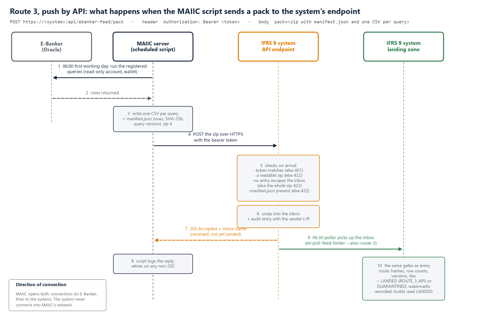
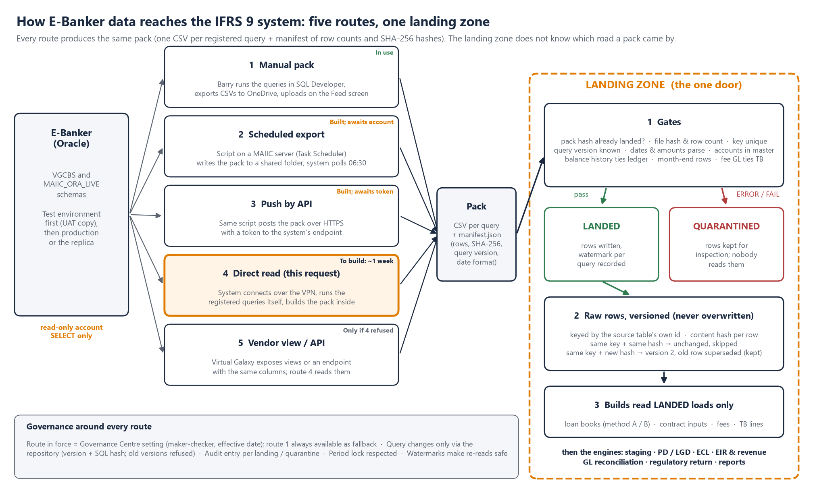
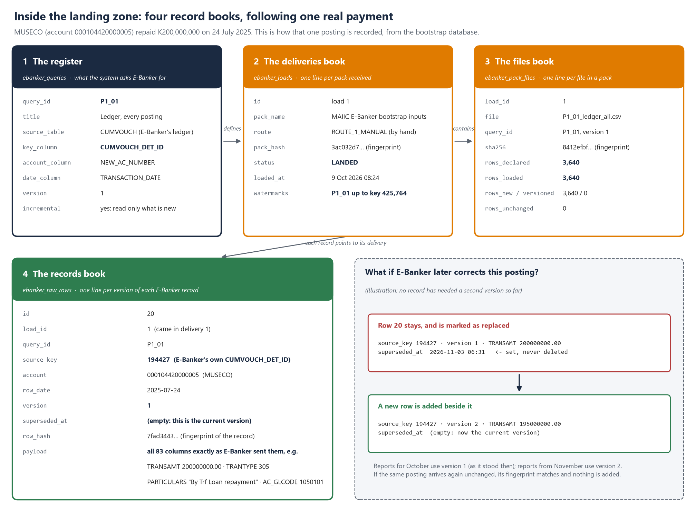
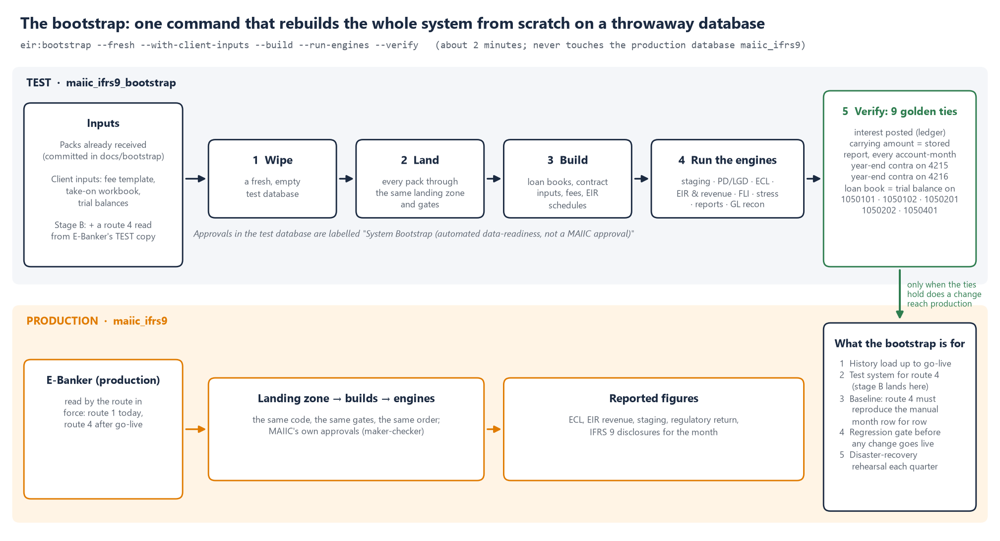
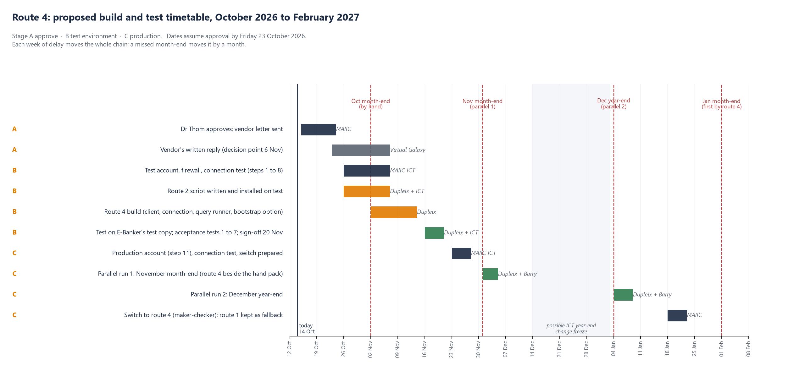

## 1. What we are asking for

We are asking for a **read-only database account** on the E-Banker Oracle database. The IFRS 9 system's server, which is being installed on MAIIC's own network, would use it to run the monthly extracts on a schedule, instead of your team running them by hand in SQL Developer. Nothing else changes. The queries, the tables and the checks on arrival all stay the same.

In practical terms, we need five things:

1. An Oracle user with `CREATE SESSION` and `SELECT` on the tables listed in the annex (schemas VGCBS and MAIIC_ORA_LIVE), and nothing more. It should have no insert, update, delete or DDL rights, and no right to execute any package or procedure.
2. A firewall rule that lets that one server reach the database listener on MAIIC's network. That server is the MAIIC server the IFRS 9 system is installed on, so you already know its IP address. The port is 1521 unless E-Banker uses another.
3. The connection details (host, service name and port), and a short test window with ICT present.
4. Access to a standby or reporting replica instead of production, if E-Banker runs one. The queries are read-only either way, but a replica takes away any question of load on the live system.
5. **The same account, set up first on E-Banker's test environment.** That means the UAT or test copy of the database if MAIIC has one, or otherwise a restored copy of a recent backup. Everything is proved there before the production account is switched on (section 9).

**We would ask you to plan this now.** The build takes about a week. What sets the pace is everything around it: approvals, the vendor's reply, a test copy of E-Banker and two month-ends of parallel running. If the route is to be proven on the November month-end and run in parallel on the December 2026 year-end, we need approval by **Friday 23 October 2026**. Section 9.2 sets out the timetable.

## 2. Why

Since 7 October the system has been fed by packs that your team runs in SQL Developer on its own machine and exports by hand, with Dupleix watching over AnyDesk. That works, and it will stay as the fallback. Even so, every pack has needed a second run. Sometimes the date settings were not applied in the worksheet. Sometimes an export stopped early at SQL Developer's 100 MB grid. And one table, the overdue run, is too large to export at all, because it writes one row per account per day. A scheduled read by the system avoids all of these. It sets up its own session, it has no grid, and it reads in pages.

For every file it lands, the system already records which query produced it, the row count, a hash and the checks it passed. A direct read produces exactly the same record. The audit trail Deloitte sees will therefore be the same whether a month came in by hand or on schedule.

### 2.1 Where things stand (14 October 2026)

- **How the queries are run today.** Your team prefers to run every pack on its own machine, in SQL Developer, while Dupleix watches the session over AnyDesk. This is route 1 (section 3), supervised. MAIIC keeps its hands on its own database, and Dupleix sees each query run and can correct a setting on the spot. Ten packs have been run this way. Pack 10 was prepared on 14 October during the system build (section 10 and the annex).
- **The system is moving onto MAIIC's server.** MAIIC ICT has been added as a collaborator on the system's code repository and has already cloned it onto a MAIIC server, where the IFRS 9 system is now being set up. The first thing to run there is the bootstrap (section 8). It rebuilds the system from every pack received so far and checks the nine golden ties, which proves the installation before anything else is done. The production database is created at the same time, empty.
- **What that changes for this request.** The system's server sits on MAIIC's own network, so every connection in routes 2, 3 and 4 stays inside MAIIC. E-Banker data never leaves your network, and no outside party connects to the database. AnyDesk and the VPN are kept only for Dupleix's remote support.
- **What comes next.** The integration work this document describes. The read-only account is tested first against E-Banker's test copy and the bootstrap database, and then on production, following the timetable in section 9.2.

### 2.2 How each change reaches MAIIC's server

The copy of the system on MAIIC's server is a clone of the code repository, so **nothing Dupleix builds reaches it until MAIIC ICT pulls it**. Every piece of the integration work goes through the same release steps before it is tested on your server. That covers the route 2 script, the route 4 connection and query runner, the bootstrap option and any route 3 hardening.

| Step | Who | What |
|---|---|---|
| 1. Build and prove at Dupleix | Dupleix | We build the change, its automated tests pass, and the bootstrap passes all nine golden ties on Dupleix's copy |
| 2. Push | Dupleix | We push the change to the repository with a note of what it does and which step of this plan it belongs to, and tell MAIIC ICT it is ready |
| 3. Pull on MAIIC's server | MAIIC ICT, with Dupleix watching over AnyDesk | `git pull` on the server's clone, then `php artisan migrate --force` for any new database tables or columns. Run `composer install` as well when the release note says the libraries changed |
| 4. Re-run the bootstrap on MAIIC's server | MAIIC ICT, with Dupleix | `php artisan eir:bootstrap` on the bootstrap database. All nine golden ties must pass on MAIIC's server before the change is tested there |
| 5. Test | MAIIC ICT and Dupleix | The tests in section 9 for that step |

If a change fails step 4, it is not tested and goes no further. Dupleix fixes it and the steps start again. Production is updated by the same pull, only after the tests pass, and never by copying files onto the server. That way the repository's history shows exactly what was running on MAIIC's server on any date.

## 3. Background: the five feed routes

However the data travels, the system takes E-Banker data in through one door, the landing zone. Every route produces the same thing, a pack: one file per registered query, plus a manifest of row counts and hashes. Every pack passes the same checks before anything is used. Moving from one route to another therefore changes nothing in the figures. It changes only who runs the queries and how the files travel. The route in force is a governed setting in the system, and the manual route always stays available for a missed month or a correction.

| Route | How it works | What it needs | Status |
|---|---|---|---|
| **1. Manual pack** | MAIIC ICT runs the versioned queries in SQL Developer on its own machine while Dupleix watches over AnyDesk. It exports one CSV per query and saves them to the shared OneDrive folder, and the system's Feed screen lands them | Nothing new | **In use since 7 October**, and supervised over AnyDesk since pack 9. Every pack to date has come this way. It is exposed to the three problems described in section 2 |
| **2. Scheduled export at MAIIC** | A script written by Dupleix (Oracle SQLcl) runs the same queries on a MAIIC server through Windows Task Scheduler on the first working day after month-end. It writes the pack to a shared folder, which the system polls at 06:30 before landing the pack | A read-only Oracle account for the script, one shared folder, and MAIIC installing the task | **Built on the system side**, where the folder poller already runs daily. It is waiting for the account and the task at MAIIC |
| **3. Push by API (the endpoint)** | The same script zips the pack and sends it over HTTPS with a token to the system's endpoint, `POST /api/ebanker-feed/pack`, instead of using a folder. The system replies at once and lands the pack at its next poll (section 3.1) | A token issued by the system, and outbound HTTPS from the MAIIC server to the system's server | **Built on the system side**: the endpoint exists and has been tested. It is waiting for the token and the script. It is the alternative to route 2 where a shared folder between the two servers is awkward |
| **4. Direct read** (this request) | The system connects read-only to E-Banker's Oracle database from its own server on MAIIC's network, runs the registered queries itself on schedule and lands the result. The pack and manifest are generated inside the system, so the audit trail is the same as for a manual pack | The read-only account and firewall rule in section 1, the Oracle client on the system server, the vendor's consent (section 7) and Dr Thom's authorisation | **Not built yet.** It will take about a week once the account exists. This is where we want to end up, with no person in the loop and no export limits |
| **5. Vendor view or API** | Virtual Galaxy provides a reporting schema of views, or an endpoint, carrying the same columns, and route 4 reads that instead of the tables | A change request to the vendor, which will probably be paid | **Not built.** We would only need it if the vendor will not allow route 4 on the tables themselves |

Routes 2 and 4 use the **same read-only account**. That is why the sequence in section 9 starts with route 2. It proves the account, the queries and the month-end timing without new software on either side, while we wait for the vendor's consent to route 4.

### 3.1 Route 3 in detail: the endpoint

An **endpoint** is an address on the IFRS 9 system's web server that accepts a delivery from another computer, much as a web page accepts a form. Route 3 uses one: `POST https://<system server>/api/ebanker-feed/pack`. The MAIIC script runs the same queries as under route 2. The only difference is that it sends the pack straight to this address instead of leaving it in a shared folder. Figure 3 shows the exchange.

**What the endpoint does with each delivery, in order.** This is how it is built today.

| Step | What happens | If it fails |
|---|---|---|
| 1. The token | The request must carry `Authorization: Bearer <token>`. The system compares the token with the one configured on its server (`EBANKER_FEED_TOKEN`) in a way that does not give away its length or content through timing | Refused with 401, and nothing is stored |
| 2. The file | The body must carry one file, with the field name `pack`, and it must be a readable zip | Refused with 422 |
| 3. The names inside the zip | Every entry name is checked before anything is written. A name that would write outside the inbox (for example `../../`) causes the whole zip to be refused, and the attempt is logged with the sender's IP | Refused with 422 and logged as a warning |
| 4. The manifest | The zip must hold `manifest.json`, either at the top or in one sub-folder | Refused with 422 |
| 5. Into the inbox | The zip is unpacked into its own inbox folder, named by date, time and the first characters of the file's hash. An audit entry, "E-Banker Pack Received by API", records the inbox and the sender's IP | |
| 6. The reply | `202 Accepted`, with the inbox name. A 202 means the pack has been **received, not yet landed** | |
| 7. The landing | At the poller's next run (daily at 06:30, `eir:poll-feed-folder --also-route-3`), the pack goes through the landing zone exactly as it would under any other route. It passes the gates, is landed or quarantined, and its rows are versioned and watermarked. The load is recorded as route `ROUTE_3_API` | Quarantined, with the failures named |

If a pack is sent twice, step 7 recognises it by its manifest hash and does not land it again (section 11).

**Push and pull: who opens the connection.** This is usually what decides between the routes, because it decides which firewall rule your team has to open.

| Route | Who starts it | Connection opened | Firewall rule needed | Where the E-Banker password lives | What the system holds |
|---|---|---|---|---|---|
| 1. Manual (supervised) | A person at MAIIC, watched over AnyDesk | MAIIC ICT's machine to E-Banker; then a browser upload to the system | None new | With MAIIC ICT | Nothing |
| 2. Scheduled export | MAIIC's scheduled task | MAIIC server to E-Banker; MAIIC server to a shared folder the system can read | A share both servers can reach | Oracle Wallet on the MAIIC server | Read access to the folder |
| 3. Push by API (endpoint) | MAIIC's scheduled task | MAIIC server to E-Banker; MAIIC server **out** to the system over HTTPS | Outbound HTTPS (443) from the MAIIC server to the system's server | Oracle Wallet on the MAIIC server | The feed token only |
| 4. Direct read | The system's scheduler | System server (on MAIIC's network) to E-Banker | Inbound to the database listener (1521) from the system's server | The system server's configuration | The read-only database password |
| 5. Vendor view or API | The system's scheduler | System server to the vendor's views or the vendor's own endpoint | As route 4, or to the vendor's endpoint | The system server's configuration | The vendor's credentials |

With the IFRS 9 system installed on MAIIC's own server, **every route keeps the connection to E-Banker inside MAIIC's network**. Under none of them does an outside party connect to the database. What differs is who holds the E-Banker password. Under routes 2 and 3 it stays in an Oracle Wallet on a MAIIC server, and the IFRS 9 system never holds it. Under route 4 it sits in the IFRS 9 system's configuration on MAIIC's server. Route 4 is the simplest to run, because there is no script or scheduled task for MAIIC to maintain. Routes 2 and 3 suit an ICT policy that says the reporting system itself should not hold a database login.

**Route 5's endpoint is a different thing.** Under route 5 the endpoint would belong to the vendor, not to us. Virtual Galaxy would publish an address that the system calls to fetch the data (a pull), and the system would need a small connector written to their specification. That is only worth doing if the vendor refuses route 4 and MAIIC would rather not run a script under routes 2 or 3.

**What would be added before route 3 goes live.** The endpoint works today. If route 3 is chosen, we would add four hardening items, which is about a day's work:

- **An IP allow-list**, so that only the MAIIC server's address is accepted. Today any address with the token is accepted. Until the allow-list is built, the same restriction can be set on the system server's firewall.
- **Two-token rotation**, so a new token can be issued and the old one retired without a gap. Today there is one token in the configuration.
- **Landing on receipt**, so the reply can say "landed" or "quarantined" straight away rather than waiting for the 06:30 poll. The alternative is to run the poll more often on the first working days of the month.
- **A size limit and a status address.** Oversize packs would be refused clearly, and the script could ask for the result of its last delivery. Today the limit is the web server's upload limit, which must be raised to at least 100 MB.

## 4. The landing zone technique

**What it is.** A landing zone is a holding area inside the system. Data from a source system is stored there exactly as it arrived, before anything is calculated from it. Nothing in the IFRS 9 system reads E-Banker's files directly. Every engine reads only what has passed through the landing zone, so it is the single door between E-Banker and the system's figures, whichever of the five routes delivered the data.

**Why it is built this way.**

- **One set of checks for every route.** The checks are written once and every pack must pass them. A month that came in by hand is held to the same standard as a month read directly.
- **Nothing is ever overwritten.** E-Banker changes its own records, for example when a posting is reversed or an account is re-graded. If the system overwrote what it held, a figure reported last quarter could not be reproduced. The landing zone keeps every version of every row, with the time it was superseded, so any reported month can be re-derived exactly as it was.
- **Bad data stops at the door.** A pack that fails a check is quarantined as a whole. Its rows are kept so the problem can be seen, but no engine reads them. A short export or a wrong date format can never reach the ECL or the revenue figures.
- **The audit trail is built in.** For each figure, the system can tell you which pack, file, query version and row it came from. It can also show the hash that proves the file is the one E-Banker produced.
- **Changing the route changes nothing downstream.** Every route ends in the same pack and goes through the same door. Moving from the manual route to the direct read is invisible to the engines. All it does is remove the manual steps.

**How it works, step by step.**

1. **The pack arrives.** It holds one CSV per registered query and a manifest. For each file, the manifest states the query identifier and version, the row count, the SHA-256 hash and the date format. Under the direct read, the system writes the pack and the manifest itself.
2. **The pack is identified.** The manifest's hash is checked against every pack already loaded. If the pack has already landed, the system says so and nothing is loaded twice.
3. **The gates run.** Each file must be present, with the hash and row count it declares and a unique key. Its query version must be the one in the register, and every date and amount must parse. Across the files, every ledger account must be in the account master and the balance history must tie to the ledger. Every account in scope must have its month-end row, and the fee GL movement must tie to the trial balance.
4. **Landed or quarantined.** If every error-level gate passes, the pack is LANDED. If not, it is QUARANTINED, with each failure named by file and row. Warnings are recorded but do not stop the pack.
5. **The rows are stored, versioned.** Each row is stored verbatim under the E-Banker table's own key, with a hash of its content. A new key becomes version 1 and an unchanged row is skipped. A changed row becomes the next version, and the earlier one is marked superseded. It is never deleted.
6. **The watermark is recorded.** For each history table, the system records the highest key loaded. The next read starts above it.
7. **The builds read.** The monthly loan book, the contract inputs, the fees and the trial balance lines are built from landed rows only, and each build records which loads it read. The engines then run on the builds: staging, PD and LGD, ECL, EIR and revenue, the GL reconciliation and the regulatory return.

In the system's database, the landing zone is four tables. The **query register** holds each query's identifier, source table, key, version, SQL and its hash. The **loads** table has one record per pack, with its hash, route, status, gate results and watermarks. The **pack files** table has one record per file, with its hash, the rows declared and the rows new, versioned and unchanged. The **raw rows** table holds every row of every file, in all its versions.

**How each route works, end to end.** The routes differ only in who runs the queries and how the files travel. Once a pack reaches the landing zone, every route gets the same gates, the same versioned storage and the same audit trail. That is the whole point of the design.

| Route | Who runs the queries | Where and when | How the pack travels | What starts the landing | Recorded in the load as |
|---|---|---|---|---|---|
| **1. Manual pack** | MAIIC ICT, in SQL Developer, Dupleix watching over AnyDesk | MAIIC ICT's own machine, on request | CSVs saved to the shared OneDrive folder, then uploaded on the Feed screen | A person clicks Land | `ROUTE_1_MANUAL`, with the user's name |
| **2. Scheduled export** | A script, under the read-only account | A MAIIC server, first working day after month-end (Task Scheduler) | Written to a shared folder | The system polls the folder at 06:30 and lands what it finds | `ROUTE_2_FOLDER` |
| **3. Push by API** | The same script | A MAIIC server, same schedule | Sent over HTTPS with a token | Arrival at the endpoint | `ROUTE_3_API` |
| **4. Direct read (this request)** | The IFRS 9 system itself, under the read-only account | The system's server on MAIIC's network; monthly, or daily for the overdue run | Never leaves the system: the pack is built in place | The system's scheduler | `ROUTE_4_DIRECT` |
| **5. Vendor view or API** | The IFRS 9 system, reading the vendor's views or endpoint | As route 4 | As route 4 | The system's scheduler | `ROUTE_5_VENDOR` |

### 4.1 Inside the landing zone: the four tables, explained

This part is written so that anyone at MAIIC can follow it, not only ICT. If you have ever run a receiving office, you already know how the landing zone is organised. It keeps four record books.

1. **The register** (`ebanker_queries`, section 4.2) lists everything the system is allowed to ask E-Banker for. After pack 10 there are 114 questions, each with a code (P1_01, P2_08, OD_01 …). For each one, the register records which E-Banker table it reads and which column is that table's own unique number for a record. It also records which columns hold the account and the date, the version of the question, and whether to fetch everything each time or only what is new. The system will not accept answers to a question that is not in the register.
2. **The deliveries book** (`ebanker_loads`) has one line for every pack that arrives. It shows when the pack came, by which route, its fingerprint, whether it was accepted (LANDED) or set aside (QUARANTINED) and the result of every check. It also holds the **watermark**: the last record received for each question, so that the next delivery fetches only what is new.
3. **The files book** (`ebanker_pack_files`) has one line for every file inside a pack. It shows the file's fingerprint, how many records the pack said it held and how many were actually stored, and how many of those were new, changed or already held.
4. **The records book** (`ebanker_raw_rows`) holds the records themselves, with one line for each version of each E-Banker record. A few facts are copied into labelled columns so they can be found quickly: E-Banker's own record number, the account, the date, the version, and whether this version has been replaced. Beside them, the full record is kept unchanged, with every column exactly as E-Banker sent it.

**One real payment, followed through** (Figure 4, from the bootstrap database). MUSECO repaid K200,000,000 on 24 July 2025. In E-Banker that is ledger record 194427. It arrived by hand in delivery 1, accepted on 9 October 2026, in the file `P1_01_ledger_all.csv`. That file said it held 3,640 records, and 3,640 were stored. In the records book the payment is line 20: account 000104420000005, dated 24 July 2025, version 1 and not replaced. All 83 of E-Banker's columns are kept as they were, including the amount of 200,000,000.00, transaction type 305, "By Trf Loan repayment" and loan GL 1050101.

**What happens if E-Banker later changes that record.** Suppose the payment is corrected in E-Banker to K195,000,000. At the next delivery the system sees record 194427 again, with a different fingerprint. It does **not** overwrite line 20. Instead it marks line 20 with the date and time it was replaced, and adds a new line, version 2, holding the corrected amount. Figures already reported for October were calculated from version 1 and can be reproduced exactly, while figures from November use version 2. If the record arrives again unchanged, its fingerprint matches and nothing is added. So far no record has needed a second version, and the figure shows the case only as an illustration.

**Questions you can answer from the four books** without asking Dupleix:

| Question | Where the answer is |
|---|---|
| Did this month's pack arrive, and was it accepted? | The deliveries book: the pack's line, its status and its check results |
| Was any file short or altered? | The files book: records declared against records stored, and the fingerprint |
| Which E-Banker record is behind a figure in a report? | The records book: E-Banker's record number, the delivery it came in, its version |
| Has E-Banker changed a record we had already received? | The records book: any line with a version above 1, and the date its earlier version was replaced |
| What exactly did we ask E-Banker for, and has the question changed? | The register gives each query and its version; the exact SQL is the committed query file of that version (section 4.2) |

**Have the tables been created?** Yes, in the system's test databases, where they hold the data received so far. The bootstrap database holds 65 registered questions, 23 deliveries, 75 files and 88,977 records. In the production database the tables are created empty when the system is installed on MAIIC's server, because the installation runs the same database set-up. They are then ready for the first pack. Their full column-by-column definition is in the system's code.

### 4.2 The query register, and how the queries run in Oracle

**SQL and Oracle in one paragraph.** E-Banker's data sits in an Oracle database, in tables owned by the schemas VGCBS and MAIIC_ORA_LIVE. Every extract is a single SQL `SELECT` statement. It names the columns wanted and the table, and has a `WHERE` clause that limits the rows to the MAIIC and Mega Farm schemes. For history tables, it also limits them to records after the last one received. For example, the incremental ledger read is in essence `SELECT cv.* FROM vgcbs.cumvouch cv WHERE cv.new_ac_number IN (SELECT a.new_ac_number FROM vgcbs.acmaster a WHERE a.scheme_mst_id IN (84, … , 145)) AND cv.cumvouch_det_id > :watermark ORDER BY cv.cumvouch_det_id`. A `SELECT` takes no locks on E-Banker's rows. Oracle answers it with statement-level read consistency, which means every row comes back as it stood when the statement started, even while postings continue. The read-only account can run nothing but `SELECT`.

**How a query will be executed under route 4.** This is part of the build in section 9. For each registered query, the system will take four steps.

(1) It will open a session as `MAIIC_IFRS9_RO` and set up the session itself (`NLS_DATE_FORMAT` to ISO and `NLS_NUMERIC_CHARACTERS`). This is the RUN 0 that is so often missed by hand. (2) It will bind the watermark as a parameter rather than pasting it into the text, so the statement text, and therefore its fingerprint, stays exactly as approved. (3) It will fetch the result in pages of a few thousand rows, so there is no grid limit and little memory is used on either side. (4) It will write the file and the manifest and land them through the gates.

On a busy database, Oracle may refuse a very long read with ORA-01555 ("snapshot too old"). The system will avoid this by running at 06:00, reading only rows above the watermark and splitting the largest tables, as the overdue run already is by quarter. That keeps every statement short enough.

**What the register is.** The register (`ebanker_queries`) is the system's controlled catalogue of every query it accepts from E-Banker. After pack 10 it has **114 entries**. It is seeded from the code repository (`database/seeders/EbankerQuerySeeder.php`), so it changes only through the release steps in section 2.2. Today each entry records the query's **shape**: what it reads, its key, its account and date columns, how it is read, and its version. The **SQL text itself** is kept, by version, in the committed query files under `docs/bootstrap/queries`, which are what the pack sheets print and what the E-Banker Feed screen hands out as one download. Each entry records the following:

| Field | Example (P1_01) | What it is used for |
|---|---|---|
| `query_id`, `title` | P1_01, "Ledger, every posting" | The identifier on every pack sheet, file, manifest and load record |
| `source_table` | CUMVOUCH | The E-Banker table read; drives the grant list of section 6, step 4 |
| `key_column` | CUMVOUCH_DET_ID | E-Banker's own primary key. Each row is versioned and de-duplicated under this key (section 11), and the watermark is taken from it |
| `account_column`, `date_column` | NEW_AC_NUMBER, TRANSACTION_DATE | Copied into the landing zone's typed columns, so builds can find a loan's rows for a month without reading the JSON |
| `incremental` | yes | Whether to read the whole table each time, or only rows above the watermark |
| `version` | 1 | Raised whenever the statement changes. The `query_version` gate refuses a file from any other version |
| `sql`, `sha256` | Empty today | Filled by the route 4 build: the statement route 4 will execute, and its SHA-256, so the system runs exactly the approved text and any change to it shows |

Under route 1, the committed query files are what the pack sheets print for your team to run in SQL Developer. Under routes 2 and 3, the export script carries the same statements, and under route 4 the system will execute them directly. In every case the same entry governs the same table, so a month read by one route can be compared with a month read by any other.

## 5. What the account will do, and will not do

| Will | Will not |
|---|---|
| Run the registered SELECT statements (114 in the register after pack 10, all in MAIIC's copy of the repository) | Write, change or delete any row |
| Run once a month, on the first working day after month-end, between 06:00 and 07:00; the overdue table optionally daily | Run stored procedures, create objects or change settings |
| Read a few megabytes a month: the loan accounts of the 18 MAIIC schemes and the 8 Mega Farm schemes, their ledger postings, balances, instalment charts, overdue computations and the trial balance | Read customer accounts outside those schemes, or any table not in the annex |
| Connect from one named server on MAIIC's network, with the password held by MAIIC ICT and rotated on MAIIC's schedule | Connect from anywhere else, or be used by a person |

MAIIC ICT administers the account. You can see every session it opens in the database's own audit, and you can revoke it at any time. The manual route keeps working whatever happens.

## 6. Setting up the accounts: step by step for MAIIC ICT

This section is written for MAIIC ICT. You will do the same steps twice. The first time is on **E-Banker's test environment** (stage B in section 9). The second is on **production or the replica** (stage C), and only after the tests on the test environment have passed. Both use the same account name, with different passwords. Every statement below is standard Oracle, and your database administrator runs it (a user with the DBA role or equivalent). None of it changes E-Banker's own tables, code or users. If you would rather the vendor ran the steps, you can send them this section as it stands. Dupleix is happy to join any step on a call if that helps.

**Step 1. Agree the names and the server.** Account: `MAIIC_IFRS9_RO`. Role: `IFRS9_FEED_READ`. Profile: `IFRS9_FEED_PROFILE`. You already know the IFRS 9 system's server. It is the MAIIC server the system is being installed on, and its IP address is the one the firewall rule names. The bootstrap (test) and production databases both sit on it.

**Step 2. Create a profile that limits the account.** The profile caps the number of sessions, locks the account after failed logins and forces a password change every 90 days.

- `CREATE PROFILE ifrs9_feed_profile LIMIT SESSIONS_PER_USER 2 FAILED_LOGIN_ATTEMPTS 5 PASSWORD_LOCK_TIME 1 PASSWORD_LIFE_TIME 90 PASSWORD_GRACE_TIME 7 IDLE_TIME 30;`

`SESSIONS_PER_USER` and `IDLE_TIME` take effect only when the database parameter `RESOURCE_LIMIT` is TRUE, which is the default from Oracle 12c. If it is FALSE, leave it as it is and let us know. The account works the same either way.

**Step 3. Create the user.** The user can log in but owns nothing. It has no quota, so it cannot create anything.

- `CREATE USER maiic_ifrs9_ro IDENTIFIED BY "<a strong password>" PROFILE ifrs9_feed_profile DEFAULT TABLESPACE users TEMPORARY TABLESPACE temp QUOTA 0 ON users;`
- `GRANT CREATE SESSION TO maiic_ifrs9_ro;`

**Step 4. Create a read-only role and grant SELECT on the tables in the annex.** Granting through a role means you can remove all the access with one statement.

- `CREATE ROLE ifrs9_feed_read;`
- `GRANT SELECT ON VGCBS.ACMASTER TO ifrs9_feed_read;`
- `GRANT SELECT ON VGCBS.ACLOANMASTER TO ifrs9_feed_read;`
- `GRANT SELECT ON VGCBS.CUSTOMER_MAST TO ifrs9_feed_read;`
- `GRANT SELECT ON VGCBS.SCHEME_MASTER TO ifrs9_feed_read;`
- `GRANT SELECT ON VGCBS.GLMASTER TO ifrs9_feed_read;`
- `GRANT SELECT ON VGCBS.CUMVOUCH TO ifrs9_feed_read;`
- `GRANT SELECT ON VGCBS.ACCOUNT_BALANCE TO ifrs9_feed_read;`
- `GRANT SELECT ON VGCBS.LOAN_BOOK_DETAILS_ALL TO ifrs9_feed_read;`
- `GRANT SELECT ON VGCBS.FIXLOAN_INST_CHART TO ifrs9_feed_read;`
- `GRANT SELECT ON VGCBS.MULTI_INST_DETAILS TO ifrs9_feed_read;`
- `GRANT SELECT ON VGCBS.LOAN_DISBURSMENT_SCHEDULE TO ifrs9_feed_read;`
- `GRANT SELECT ON VGCBS.ACCOUNT_STATUS_HISTORY TO ifrs9_feed_read;`
- `GRANT SELECT ON VGCBS.ACCOUNT_CLOSER_HISTORY TO ifrs9_feed_read;`
- `GRANT SELECT ON VGCBS.OVERDUE_DETAILS TO ifrs9_feed_read;`
- `GRANT SELECT ON VGCBS.INTEREST_SLAB_MASTER TO ifrs9_feed_read;`
- `GRANT SELECT ON VGCBS.INTEREST_SLAB_DETAILS TO ifrs9_feed_read;`
- `GRANT SELECT ON VGCBS.INTEREST_PRODUCT TO ifrs9_feed_read;`
- `GRANT SELECT ON VGCBS.INTEREST_SUMMARY TO ifrs9_feed_read;`
- `GRANT SELECT ON VGCBS.DAILY_INTEREST_ACCRUAL TO ifrs9_feed_read;`
- `GRANT SELECT ON VGCBS.FORGIVE_INTEREST_DETAILS TO ifrs9_feed_read;`
- `GRANT SELECT ON VGCBS.PLR_MASTER TO ifrs9_feed_read;`
- `GRANT SELECT ON VGCBS.LOS_DISB_CHARGES_POST TO ifrs9_feed_read;`
- `GRANT SELECT ON VGCBS.LOS_REQUEST_DETAILS TO ifrs9_feed_read;`
- `GRANT SELECT ON VGCBS.CHARGES_POSTING_HISTORY TO ifrs9_feed_read;`
- `GRANT SELECT ON VGCBS.DISBURSE_CHARGES_DETAILS TO ifrs9_feed_read;`
- `GRANT SELECT ON VGCBS.CUST_SECURITY_DETAILS TO ifrs9_feed_read;`
- `GRANT SELECT ON VGCBS.GUARANTER_MASTER TO ifrs9_feed_read;`
- `GRANT SELECT ON VGCBS.LOAN_RESCHEDULE_DETAILS TO ifrs9_feed_read;`
- `GRANT SELECT ON VGCBS.MODIFICATION_LOG TO ifrs9_feed_read;`
- `GRANT SELECT ON VGCBS.LOAN_WRITEOFF_MASTER TO ifrs9_feed_read;`
- `GRANT SELECT ON VGCBS.LOAN_WRITEOFF_TRANS TO ifrs9_feed_read;`
- `GRANT SELECT ON VGCBS.GL_OPENING_BALANCE TO ifrs9_feed_read;`
- `GRANT SELECT ON VGCBS.TRIAL_BALANCE_HISTORY TO ifrs9_feed_read;`
- `GRANT SELECT ON VGCBS.CUMOVUCH_OLD TO ifrs9_feed_read;`
- `GRANT SELECT ON VGCBS.CUMVOUCH_BK240824 TO ifrs9_feed_read;`
- `GRANT SELECT ON VGCBS.CUMVOUCH_BAK TO ifrs9_feed_read;`
- `GRANT SELECT ON VGCBS.GL_OPENING_BALANCE_BK240824 TO ifrs9_feed_read;`
- `GRANT SELECT ON VGCBS.FIXLOAN_INST_CHART1 TO ifrs9_feed_read;`
- `GRANT SELECT ON VGCBS.FIXLOAN_INST_CHART_300824 TO ifrs9_feed_read;`
- `GRANT SELECT ON VGCBS.FIXLOAN_INST_CHART_141124 TO ifrs9_feed_read;`
- `GRANT SELECT ON VGCBS.FIX_INST_CHART28SEP TO ifrs9_feed_read;`
- `GRANT SELECT ON VGCBS.OPENING_BAL TO ifrs9_feed_read;`
- `GRANT SELECT ON VGCBS.ACCOUNT_NO_MAPP TO ifrs9_feed_read;`
- `GRANT SELECT ON VGCBS.NEW_ACMAP TO ifrs9_feed_read;`
- `GRANT SELECT ON VGCBS.T_ACCOUNT TO ifrs9_feed_read;`
- `GRANT SELECT ON VGCBS.T_ACCOUNTBALANCE TO ifrs9_feed_read;`
- `GRANT SELECT ON VGCBS.TEMP_MASTER TO ifrs9_feed_read;`
- `GRANT SELECT ON VGCBS.G_ACMASTER TO ifrs9_feed_read;`
- `GRANT SELECT ON VGCBS.ACMASTER_MW TO ifrs9_feed_read;`
- `GRANT SELECT ON VGCBS.ACMASTER_NF TO ifrs9_feed_read;`
- `GRANT SELECT ON MAIIC_ORA_LIVE.CRM_ACMASTER_05082024 TO ifrs9_feed_read;`
- `GRANT ifrs9_feed_read TO maiic_ifrs9_ro;`

If a grant fails with ORA-00942 (table or view does not exist), that table sits in a different schema on MAIIC's installation. Skip it and send us the error, and we will correct the schema. Nothing else is granted. There is no INSERT, UPDATE, DELETE, EXECUTE or CREATE TABLE, and no ANY privilege. The data dictionary views in the annex need no grant, because they show only the tables the account can already see.

**Step 5. Switch on auditing for the account.** This lets MAIIC see every session the account opens and every statement it runs. On Oracle 12c and later with unified auditing:

- `CREATE AUDIT POLICY ifrs9_feed_audit ACTIONS LOGON, LOGOFF, SELECT;`
- `AUDIT POLICY ifrs9_feed_audit BY maiic_ifrs9_ro;`

On an older database using traditional auditing, run `AUDIT SESSION BY maiic_ifrs9_ro;` and `AUDIT SELECT TABLE BY maiic_ifrs9_ro BY ACCESS;`. The records appear in `UNIFIED_AUDIT_TRAIL` (or `DBA_AUDIT_TRAIL`).

**Step 6. Open the network path.** On the firewall, allow the system's server (one IP on MAIIC's network) to reach the database listener on its port, and nothing else. The port is 1521 unless E-Banker uses another. You do not need to change the listener or `sqlnet.ora`. Restricting by IP on the firewall, rather than in the database, keeps the change outside E-Banker.

**Step 6a. Test the connection.** Before trying anything else, confirm that the account can reach the database from the right computer. Run the test from the computer that will actually use the account. For route 4 that is the IFRS 9 system's server, with Dupleix on the call. For routes 2 and 3 it is the MAIIC server.

1. **Is the database reachable on the network?** In PowerShell on that computer, run `Test-NetConnection <database host> -Port 1521`. It must show `TcpTestSucceeded : True`. If it shows False, the firewall rule from step 6 is not yet in place.
2. **Can the account log in?** In SQLcl, run `sql maiic_ifrs9_ro@//<database host>:1521/<service name>` and enter the password when asked. In SQL Developer, create a new connection with the same details and click **Test**. It must show "Status: Success".
3. **Who, where and when: the test-connection query.** Once logged in, run:

`SELECT USER AS connected_as, SYS_CONTEXT('USERENV','DB_NAME') AS database_name, SYS_CONTEXT('USERENV','SERVICE_NAME') AS service_name, SYS_CONTEXT('USERENV','IP_ADDRESS') AS connected_from, TO_CHAR(SYSDATE, 'YYYY-MM-DD HH24:MI:SS') AS database_time FROM dual;`

It must return one row. That row shows `MAIIC_IFRS9_RO` and the name of the **test** database at stage B, or the **production** or replica name at stage C, never the other way round. Under `connected_from` it shows the IP address of the computer you are on. A wrong database name here is the mistake that matters most, so please check it before going further.
4. **Can it read what it should?** Run:

`SELECT COUNT(*) AS maiic_loan_accounts, MAX(a.account_open_date) AS latest_account_opened FROM vgcbs.acmaster a WHERE a.scheme_mst_id IN (84,85,86,87,88,89,90,91,92,93,94,95,140,141,142,143,144,145);`

It must return a count above zero and a recent date. On the test environment, the figures will reflect the date the test copy was taken.

Save the four results in a text file named `Connection test - <test or production> - <date>.txt` in the E-Banker Integration folder, together with the output of step 7.

**Step 7. Prove the account is read-only before handing it over.** Log in as `MAIIC_IFRS9_RO` in SQL Developer and run the following:

1. `SELECT * FROM session_privs;` must return only `CREATE SESSION`.
2. `SELECT owner, table_name FROM all_tables WHERE owner IN ('VGCBS','MAIIC_ORA_LIVE') ORDER BY 1, 2;` must list only the tables in the annex.
3. `SELECT COUNT(*) FROM vgcbs.acmaster;` must return a count.
4. `DELETE FROM vgcbs.acmaster WHERE 1 = 0;` must fail with ORA-01031 (insufficient privileges). Even if the test went wrong it would delete nothing, because `WHERE 1 = 0` matches no row.
5. `CREATE TABLE ifrs9_probe (x NUMBER);` must fail with ORA-01031 or ORA-01950.

6. Run pack 10's **RUN 8a (DD_17)** and **RUN 8b (DD_18)** under the new account, exactly as written in the pack. DD_17 must show `MAIIC_IFRS9_RO` as the login, and where each table name points. DD_18 must return **1 on every one of its 35 lines**, one for each table the packs read. If a line errors, the grant in step 4 is missing for that table.

Save the output of all six as a text file in the E-Banker Integration folder. It is the evidence that the account is read-only, and it serves as acceptance test 1 in section 9.

**Step 8. Hand over the connection details, and the password separately.** Send Dupleix the host, port and service name. Email is fine for these, but please do not email the password. Under route 4, MAIIC ICT types the password into the system server's configuration file itself, or reads it out on a call. Under route 2, it is stored in an **Oracle Wallet** on the MAIIC server (`mkstore`, or the SQLcl secure credential store), so it never appears in the script.

**Step 9. For route 2 only: the server, the folder and the task.** Use a MAIIC Windows server that can reach the database. First, install Oracle SQLcl, which is a single folder and needs Java 11 or later. Next, create a shared folder (for example `\\<server>\ifrs9_feed`) that the scheduled task can write to and the IFRS 9 system's server can read. Then create a Windows scheduled task, run by a service account, that runs Dupleix's export script at 05:30 on the first working day after month-end. Dupleix supplies the script and will join the first run.

**Step 9a. For route 3 only: the outbound connection and the token.** Instead of setting up a shared folder, allow the MAIIC server to make outbound HTTPS connections (port 443) to the IFRS 9 system's server, and open nothing else. Dupleix issues a token, which is a long random string, and gives it to MAIIC ICT on a call rather than by email. MAIIC ICT stores it in the Windows Credential Manager of the service account that runs the task, not in the script. The script sends each pack with the built-in Windows command `curl.exe -f -X POST "https://<system server>/api/ebanker-feed/pack" -H "Authorization: Bearer <token>" -F "pack=@<pack>.zip"`. It writes the reply to its log, and if the reply is not 202 it tries again, up to three times. Test it once with a deliberately wrong token. The reply must be 401.

**Step 10. Look after the account.** Every 90 days, run `ALTER USER maiic_ifrs9_ro IDENTIFIED BY "<new password>";` and then update the system's configuration (or the wallet). To pause the feed at once, run `ALTER USER maiic_ifrs9_ro ACCOUNT LOCK;`, and use `ACCOUNT UNLOCK` to resume. To end it, run `DROP USER maiic_ifrs9_ro;` and `DROP ROLE ifrs9_feed_read;`. For route 3, the feed token is changed on the same 90-day cycle, with the new token put on the system's server and in the Credential Manager on the same day. When the system needs a new table, Dupleix will send you one line, `GRANT SELECT ON <table> TO ifrs9_feed_read;`, for MAIIC to approve and run.

**Step 11. Repeat on production at stage C.** Repeat steps 2 to 8 on production, or on the replica the vendor names, with a new password and the production server's IP. Run steps 6a and 7 again and save their output beside the test results. Check that step 6a now names the production (or replica) database.

### 6.1 How the connection will be configured on the IFRS 9 system, and kept secure

Route 4 is not built yet, so this part describes how the build will hold the connection. It will follow the way the system already keeps its own database password.

**Where the details live.** The connection details go in the system's environment file on MAIIC's server: `.env` for production and `.env.bootstrap` for the bootstrap database. They never go in the code or in the system's database.

| Setting | Example | Held as |
|---|---|---|
| `EBANKER_DB_HOST` | the database server's name or IP | plain text |
| `EBANKER_DB_PORT` | 1521 | plain text |
| `EBANKER_DB_SERVICE` | the Oracle service name (test copy or production) | plain text |
| `EBANKER_DB_USERNAME` | `MAIIC_IFRS9_RO` | plain text |
| `EBANKER_DB_PASSWORD` | the password from section 6, step 8 | secret, typed in by MAIIC ICT and never shown on screen or in any log |

The build will add a separate database connection called `ebanker` that reads only these settings. The system's own MySQL connection is left untouched, so the two can never be mixed up.

**Kept out of the code repository.** The environment files are already excluded from the repository (`.gitignore` lists `.env`, `.env.bootstrap`, `.env.demo` and the others). A pull from the repository (section 2.2) therefore never carries a password onto MAIIC's server or off it. The only one in the repository is `.env.example`, which lists the setting names with empty values.

**Who types the password.** MAIIC ICT enters `EBANKER_DB_PASSWORD` directly on the server. Dupleix may watch the AnyDesk session while the other settings are entered, but never sees or holds the password. It is never sent by email or chat.

**Protecting the file on the server.**

- **File permissions.** Only the account the system runs under and the server's administrators can read the environment file. On Windows that is an NTFS permission on the file, and on Linux it is `chmod 600`.
- **Optional encryption at rest.** Laravel 10 can encrypt the environment file (`php artisan env:encrypt`). The file on disk is then unreadable without a key, which MAIIC ICT holds and which is not stored on the same disk. If MAIIC's policy asks for encryption at rest, this is how you meet it.
- **The configuration cache.** If the system's configuration is cached for speed (`php artisan config:cache`), the cached file carries the same values and gets the same permissions.

**Test and production kept apart.** The bootstrap database's file (`.env.bootstrap`) points only at E-Banker's test copy, and the production file (`.env`) points only at production or the replica. Before first use, the connection test in section 6, step 6a, is run from each. It names the database it reached, so a wrong pairing shows up there before anything is read.

**What the system itself will do with the connection.**

- **One user.** Only the feed runner will use the `ebanker` connection. No screen in the system will show, edit or test the credentials, and no report or export will be able to reach them.
- **Read-only session as well as a read-only account.** Each session will start with `SET TRANSACTION READ ONLY`. The account cannot write anyway (section 6), so this is a second guard, in the system's own code.
- **Registered statements only.** The route 4 build will store each approved statement and its fingerprint in the register (section 4.2). The runner will execute only those statements, and only when the fingerprint still matches. It cannot run a statement typed in by hand.
- **No secrets in logs.** Each run will be written to the audit trail with the queries run, the rows read and the timings, but never with the password or the full connection string. Errors will be logged with only the Oracle error number and the query identifier.
- **A connection-test command.** The build will add a command that runs the step 6a query from the system itself and prints who it connected as, to which database and from where. Your team can then check the connection at any time without opening SQL Developer.

**Encryption on the network.** The connection runs inside MAIIC's own network (section 2.1). If MAIIC's policy still requires encryption, Oracle's network encryption can be switched on from the system's side alone, in the Oracle client's `sqlnet.ora` on the IFRS 9 server (`SQLNET.ENCRYPTION_CLIENT = REQUIRED`). Oracle databases accept encrypted connections by default, so nothing changes on E-Banker.

**Changing or withdrawing the password.** Every 90 days (section 6, step 10), MAIIC ICT changes the password in Oracle. You then update `EBANKER_DB_PASSWORD` on the server, clear the configuration cache (`php artisan config:clear`, then `config:cache` if it is used) and run the connection-test command. Locking the account in Oracle stops the feed at once, whatever the file says.

**Backups.** The environment file is not part of the database backups described in section 13, so no backup copy carries the password. MAIIC ICT keeps the password, and the encryption key if one is used, in its own password vault so that the server can be rebuilt.

## 7. What we need from Virtual Galaxy

The account itself is MAIIC ICT's to grant. We ask the vendor to confirm the following in writing:

1. That a read-only account used in this way does not affect the support or warranty terms of the E-Banker agreement.
2. Whether access should be to production or to a standby or reporting replica, and, if a replica exists, how often it is refreshed.
3. Any audit or logging the vendor requires on such an account.
4. Whether there is any cost.
5. If the vendor cannot accept direct read access, a quotation for the alternative. That would be a reporting schema of views, or a scheduled export run by the vendor, carrying the columns of the tables in the annex. The system can read either in the same way.

Two other vendor questions are open in any case and can go in the same message. The first is the **Reschedule Report**, which concerns restructure history: LOAN_RESCHEDULE_DETAILS is empty, yet OPENING_BAL shows eight restructures. The second is the **write-off record**: LOAN_WRITEOFF_MASTER is empty, yet the ledger carries type 300 write-off postings.

## 8. The bootstrap: how the integration is tested before production

**What the bootstrap is.** The bootstrap is one command in the IFRS 9 system, `eir:bootstrap`. It rebuilds the whole system from scratch on a separate, throwaway database (`maiic_ifrs9_bootstrap`) and proves the result. It takes about two minutes and never touches the production database (`maiic_ifrs9`). We have run it after every change since 8 October, and it produced the figures in every review and audit to date.

**What it does, in order.**

1. **Wipe.** It empties the test database and creates it again from the system's own definitions.
2. **Land.** It takes every pack MAIIC has sent so far, which are kept with their hashes in the project repository, together with the client inputs: Finance's fee template, the take-on workbook and the trial balances. It lands them through the same landing zone and the same gates as production (section 4).
3. **Build.** It builds the monthly loan books, the contract inputs, the fees and the EIR schedules from the landed rows.
4. **Run the engines.** It runs staging, PD and LGD, ECL, EIR and revenue, the forward-looking chain, sensitivity and stress, the reports, the compliance register and the GL reconciliation. It does this month by month, in the same order as production.
5. **Verify.** It checks nine **golden ties**, which are figures that must agree exactly with an independent source. They cover the interest posted in the ledger, and the carrying amount against E-Banker's stored loan book report for every account and month. They also cover the year-end interest contra entries on GL 4215 and 4216, and the loan book against the trial balance on the five loan GLs (1050101, 1050102, 1050201, 1050202, 1050401). Today all nine pass.

Anything approved inside the test database is labelled "System Bootstrap (automated data-readiness, not a MAIIC approval)". Only MAIIC's own approvals, in production, count.

**Where it fits in this integration.**

| Role | What it means for the integration |
|---|---|
| **History load** | The packs received by hand since 7 October are the history up to go-live. The bootstrap builds that history in a way that can be reproduced, and route 4 then only reads forward from the watermarks the history leaves. |
| **The test system** | In stage B (section 9), route 2 and route 4 land into the bootstrap database, not production. The test account on E-Banker's test environment is paired with this test database, so nothing live is read or written on either side. |
| **The baseline** | The bootstrap already holds each month as it arrived by hand. A month read by route 4 must land against it as "all unchanged", with no new rows and no new versions. Any difference is named row by row. It is either a query to correct or a genuine change in E-Banker that needs explaining. |
| **The regression gate** | Before any change reaches production, whether a new query version, an engine change or a change of route, the bootstrap is re-run and the nine golden ties must still pass. |
| **Disaster-recovery rehearsal** | The quarterly restore test in section 13 uses the same mechanism. It rebuilds, runs the ties and records the result. |

For stage B, the bootstrap will gain one option. It will be able to take a fresh read from E-Banker's test environment by route 4 as well as the committed packs, so the whole test runs under one command. This is part of the route 4 build in section 9, not separate work.

## 9. Proposed sequence: test environment first, then production

Nothing touches production until it has worked end to end on the test environment. The system has its own test databases, separate from the live one and already used for every build and audit to date. The test stage therefore pairs E-Banker's test environment with the system's test database, which is the bootstrap database described in section 8. No live data on either side is read or written until stage C.

| Stage | Step | Who | When |
|---|---|---|---|
| **0. Install** | The IFRS 9 system is installed on MAIIC's server, the bootstrap is run there and all nine golden ties pass. The production database is created, empty | Dupleix with MAIIC ICT (over AnyDesk) | This week |
| **A. Authorise** | Dr Thom authorises the request, and MAIIC raises the points in section 7 with the vendor | MAIIC | This week |
| **B. Test environment** | The read-only account is created on E-Banker's test environment (UAT, or a restored recent backup) following steps 1 to 8 of section 6, and the firewall rule is opened from the system's server on MAIIC's network | MAIIC ICT | On authorisation |
| | Route 2 on test. The scheduled script runs against the test database, writes the pack to a test folder, and the pack is landed into the bootstrap database | Dupleix writes the script, MAIIC ICT installs the task | Within two weeks of the account |
| | Route 3 on test, if MAIIC prefers it to route 2 or 4. The same script posts to the test system's endpoint with a test token (section 6, step 9a), and a wrong token must be refused | Dupleix and MAIIC | Alongside route 2 |
| | **Release before every test.** Dupleix pushes each piece of the build, and MAIIC ICT pulls it onto its server and migrates it. The bootstrap is then re-run there, with all nine ties passing (section 2.2) | Dupleix and MAIIC ICT | Before each test below |
| | Route 4 on test. The Oracle client and connection are installed on the system's server, and the system runs the queries itself against E-Banker's test environment, landing into the bootstrap database | Dupleix | On the vendor's confirmation, taking about a week |
| | **Acceptance on test**, signed off by MAIIC ICT and Dupleix. (1) The connection test in section 6, step 6a passes from the system's server, every registered query runs under the account, and nothing outside the annex can be read, as shown by the saved outputs of steps 6a and 7. (2) A month read by route 4 lands against the bootstrap's hand-received copy of the same month as all unchanged, with the same rows and hashes and no new versions. (3) A re-read of the same month lands as all unchanged, with no duplicates. (4) A deliberately broken file is quarantined and nothing downstream moves. (5) The read takes under 15 minutes and the database shows no measurable load. (6) A backup is restored and re-read from its watermarks. (7) The bootstrap, re-run with the route 4 data, passes all nine golden ties | Dupleix and MAIIC ICT | At the end of stage B |
| **C. Production** | The same account is created on production (or the replica, as the vendor advises) following section 6, step 11. The connection is pointed at it, and the route setting is changed to route 4 under maker-checker | MAIIC ICT, Dupleix, and an approver in the Governance Centre | After acceptance on test |
| | **Parallel run.** Two month-ends are read by route 4 alongside the manual pack. Each pair must tie row for row before the manual pack is stood down | Dupleix and MAIIC | Two month-ends |
| | Switch. Route 4 goes into force, and route 1 is kept as the fallback | MAIIC | After the parallel run |

If the vendor declines route 4 (section 7, item 5), stages B and C run the same way on route 2, which needs no vendor change, or on the vendor's views under route 5.

### 9.1 Why this must be planned now, not after go-live

We need to plan this route early. The build itself takes about a week. Most of the time goes on things outside the build, many of them outside Dupleix's control, and they can only happen in a fixed order.

- **Approvals and the vendor take weeks, not days.** Before anything can be tested, we need Dr Thom's authorisation and the vendor's written confirmation of support terms. MAIIC's own change control for a new database account and a firewall rule also has to be complete.
- **A test copy of E-Banker has to exist.** If MAIIC does not already have a UAT copy, one has to be restored from a backup. That takes ICT and vendor time, which needs booking.
- **Proof needs real month-ends, and there is only one a month.** The parallel run needs two month-ends read both ways and tying row for row. If we miss the November month-end, the earliest switch moves from January to February, and every further missed month-end moves it by a full month.
- **Year-end is the month that matters most.** The December 2026 year-end feeds the annual financial statements and Deloitte's audit. If route 4 is proven on November and run in parallel on December, the auditors get the strongest evidence we can give them: the same figures by two independent routes. If we start later, the year-end will be read by hand only.
- **Year-end change freezes.** Many ICT teams freeze changes over December. We have therefore scheduled everything that changes MAIIC's systems to finish by **27 November**. That includes the accounts, the firewall rule and the production set-up.
- **The manual route carries risk every month it remains the only one.** Every pack so far has needed a re-run, and the overdue table cannot be exported by hand at all. Until route 2 or 4 is live, those risks come back at every month-end.

### 9.2 Proposed build and test timetable

The dates assume Dr Thom approves by **Friday 23 October 2026**. Each week of delay moves the whole chain, and a missed month-end moves it by a month. Month-end reading days fall on the first working day after month-end.

| Stage | What | Who | Dates (2026 to 2027) |
|---|---|---|---|
| **0** | The IFRS 9 system is installed on MAIIC's server, the bootstrap is run there and the nine golden ties are checked. The production database is created, empty | Dupleix with MAIIC ICT (AnyDesk) | Thu 15 to Fri 23 October |
| **A** | Dr Thom approves the request, and MAIIC sends the vendor letter (section 7) | MAIIC | Thu 15 to Fri 23 October |
| **A** | The vendor's written reply. **Decision point Fri 6 November**: if there is no reply, or a refusal, the same timetable continues on route 2, which needs no vendor change | Virtual Galaxy | 23 October to 6 November |
| **B** | Test account on E-Banker's test copy, with the firewall rule, connection test and read-only proof (section 6, steps 1 to 8) | MAIIC ICT | Mon 26 October to Fri 6 November |
| **B** | Dupleix writes and pushes the route 2 script, and MAIIC ICT pulls it and installs it on a MAIIC server against the test copy | Dupleix and MAIIC ICT | 26 October to 6 November |
| | *October month-end: read by hand as now (route 1)* | *MAIIC* | *Mon 2 November* |
| **B** | Route 4 build: the Oracle client and connection on the system's server, the query runner and the bootstrap option, plus route 3 hardening if route 3 is chosen | Dupleix | Mon 2 to Fri 13 November |
| **B** | **Pull onto MAIIC's server.** Dupleix pushes the route 4 build, and MAIIC ICT pulls it, migrates and re-runs the bootstrap there (section 2.2) | Dupleix and MAIIC ICT | Fri 13 November |
| **B** | Testing on the test copy into the bootstrap database, running acceptance tests 1 to 7, with **sign-off on Fri 20 November** | Dupleix and MAIIC ICT | Mon 16 to Fri 20 November |
| **C** | Production (or replica) account set up following section 6, step 11. Connection test against production, and the switch prepared in the Governance Centre | MAIIC ICT | Mon 23 to Fri 27 November |
| **C** | **Parallel run 1.** The November month-end is read by route 4 beside the hand pack, and the two must tie row for row | Dupleix and MAIIC | Tue 1 to Fri 4 December |
| | *Possible ICT year-end change freeze. No changes are made, and only the parallel run continues as planned* | | *14 December to 3 January* |
| **C** | **Parallel run 2.** The December year-end is read by route 4 beside the hand pack | Dupleix and MAIIC | Mon 4 to Fri 8 January 2027 |
| **C** | Switch. Route 4 goes into force (maker-checker), and route 1 is kept as the fallback | MAIIC | Mon 18 to Fri 22 January 2027 |
| | **First month-end by route 4 alone: January** | | **Mon 1 February 2027** |

## 10. How the queries are refreshed

Every extract is a **registered query**. The system holds a register (`ebanker_queries`) that records, for each query, its identifier (P1_01, P2_08, OD_01 and so on), the E-Banker table it reads and the table's own key column. It also records the account and date columns, a version number, and whether the table is read incrementally or whole. The SQL text of each version is kept in the committed query files under `docs/bootstrap/queries`; the route 4 build will also store it, with its hash, in the register. Both are in the repository, so a query is changed by changing the repository, not by editing a worksheet.

There are two kinds of table, with a refresh rule for each.

- **Master tables come whole each time.** These are the account master, loan master, scheme master, instalment chart in force, security, guarantors, rate slabs and PLR history. The whole table is read at each run and compared row by row with what is held, and only rows that are new or changed are stored (section 10). They are small, at hundreds of rows.
- **History tables are read incrementally.** These are the ledger postings, balance history, loan-book runs, status history, interest rows and the overdue run. After every landing, the system records a **watermark** for each query, which is the highest source key loaded (the ledger's CUMVOUCH_DET_ID, or the overdue run's OVERDUE_DET_ID). The next run reads only rows above the watermark. Under the manual route, the watermark is printed on the pack sheet so the next query starts from it. You can see this in the "ids ledger 439206 / balances 363004 / runs 808196" lines on the pack 3 sheet. Under the scheduled and direct routes, the system applies the watermark itself. Nothing is ever re-read in full unless someone asks for it.

On timing, the month-end pack is read on the first working day after month-end, by which time the loan-book run and the trial balance have been produced. The overdue run can be read daily or at month-end only. A month can be re-read at any time, for a correction or a late posting, and the same rules apply. New rows are added, changed rows become a new version and unchanged rows are left alone.

Changing a query, for example to add a column or correct a filter, means a **new version in the register**. Each pack's manifest states the version of every file in it. If a file's version is not the one the register holds, the `query_version` gate refuses it, so an old script cannot feed the system unnoticed. What the gate checks today is the query's identifier and version as stated in the manifest, not the SQL text itself. Under route 1 the SQL run is the committed file for that version; once the route 4 build stores each statement's hash in the register, the system runs and checks the exact text itself.

## 11. How duplicates are handled

Duplicates are dealt with at three levels. All three are automatic, and none of them overwrites anything.

| Level | Rule | What happens |
|---|---|---|
| **Pack** | Each pack's manifest is hashed (SHA-256) | A pack that has already landed is recognised and reported as ALREADY_LANDED, and nothing is loaded twice. A pack refused earlier and offered again counts as a fresh attempt and is recorded whole |
| **File** | Each file's hash and row count must match its manifest, and the key column must be unique within the file | A short or altered file is refused, with the row named. If a key repeats inside a file, the file is refused, because that is a sign the export doubled up |
| **Row** | Every row is stored under the source table's own key (CUMVOUCH_DET_ID, OVERDUE_DET_ID, ACCOUNT_BAL_MST_ID …) with a hash of its content | Same key and same content: counted as unchanged and skipped. Same key and different content: stored as **version 2**, with the earlier row marked superseded and timed, never deleted. A new key is stored as version 1 |

This means an overlap between two extracts of the same table lands only once. Examples are the month-end overdue rows in OD_01 and the daily rows in OD_02, or a ledger re-run that pulls keys already held. Every landing records, for each file, how many rows were new, versioned and unchanged. A pack that was entirely duplicate therefore shows as "0 new, 0 versioned, N unchanged" rather than as a silent double count. And because superseded rows are kept with their dates, any month can be re-derived exactly as it looked when it was first reported.

## 12. Governance around the feed

- **Gates before anything moves.** Every pack must pass the checks within each file listed in the manifest: the file exists, the hash and row count match, the key is unique, dates and amounts parse, and the query version is known. It must also pass the checks across files. Every ledger account must be in the account master, and the balance history must tie to the ledger. Every in-scope account must have its month-end loan-book row, and the fee GL movement must tie to the trial balance. An ERROR-level failure **quarantines the whole pack**. Its rows are kept so the refused file can be opened and examined, but no reader in the system sees them and nothing downstream moves (loan book, staging, ECL, EIR). WARNING-level results are recorded against the load but not enforced.
- **Only landed loads are read.** Every build reads from landed loads only and records which loads it read, so any figure in a report can be traced to the pack and file it came from.
- **Audit trail.** Each landing and each quarantine writes an audit entry showing the route, who or what loaded it, the files, the gate results and the watermarks. With the query register, the manifest and the file hashes, an auditor can re-check that the file landed is the file E-Banker produced.
- **Period lock.** Once a reporting month is locked (maker-checker, Governance Centre), its engines do not re-run on new data. A late pack still lands, but its effect is taken in the month that is open, with the difference shown. Landing never bypasses the lock.
- **The route is a governed setting.** The route in force (manual, scheduled folder, API push, direct read or vendor view) is a Governance Centre setting, changed under maker-checker with an effective date. Whichever route is in force, the manual route stays available, so a missed month or a correction can always be loaded by hand.
- **Changes to the queries** go through the repository (version, hash and review) and the register, not through SQL Developer. The `query_version` gate enforces this.
- **The account** belongs to MAIIC ICT. MAIIC creates, holds and rotates it and can revoke it. Only one server uses it, and it is visible in Oracle's own session audit.

## 13. Data storage and backup

**Where the data sits.** Nothing is stored on the E-Banker side, because the account only reads. What it reads is stored in the IFRS 9 system's own MySQL database, on the system's server, in three layers.

| Layer | What it holds | Size today (measured 14 Oct 2026) |
|---|---|---:|
| Landing zone (`ebanker_raw_rows`, `ebanker_loads`, `ebanker_pack_files`) | Every row of every extract, verbatim, with every superseded version kept, and one record per pack with its hash, gates and watermarks | 85 MB for about two years of the MAIIC book (82,000 rows over 23 packs) |
| Built tables (loan books, EIR schedules, ECL, GL reconciliation) | Derived monthly from the landing zone, and can be rebuilt from it | 24 MB |
| The pack files themselves (CSV and manifest, under the manual and folder routes) | The files as E-Banker produced them, kept as evidence | 87 MB received to date on OneDrive |

**Growth.** On the MAIIC book, each month adds roughly 3 to 5 MB to the landing zone. Two items change the scale, and we have planned for both.

- **The Mega Farm ledger** has about 300,000 postings and has not yet been landed in full. It will add an estimated 300 to 400 MB once, then a few MB a month.
- **The daily overdue run** (OD_02) adds about 45,000 rows a year for the MAIIC schemes, an estimated 120 to 150 MB a year. The Mega Farm programme has 3,675 accounts, so its daily rows would come to about 1.3 million a year. For Mega Farm, the system therefore reads the **month-end rows only**, and the daily read stays limited to the MAIIC schemes.

On that basis the database will stay **under 2 GB for the first five years**. The server needs **at least 20 GB of free disk** for the database, its locally held backups and the pack archive, with an alert when it is 80 percent full.

**Retention.** Landed rows and pack records are kept for the life of the system and never deleted. The superseded versions are what allow a reported month to be re-derived exactly as it was, and the auditors rely on that. This goes beyond the seven-year minimum for accounting records. Once the month a pack belongs to is locked, its files may be archived off the server, because the landing zone holds every row and every file's hash.

**Backup.**

| What | How often | Kept | Where |
|---|---|---|---|
| Full database dump (compressed; about 10 MB today) | Nightly, after the 06:30 feed run has finished | 30 daily, 12 month-end, 7 year-end copies | On the server, and copied off it to MAIIC's backup store (a second site or MAIIC's cloud) |
| Month-end snapshot, taken when the month is locked | Monthly | Permanently | Off the server, alongside the month's pack files |
| The pack files and manifests | As each pack lands | Permanently | MAIIC's document store (OneDrive today) |
| The query register and the system code | On every change | The full history | The private repository, which MAIIC holds a copy of |

Every backup is **encrypted at rest**, because this is customer loan data. A **restore test** is run each quarter. The latest dump is restored to a separate database, the bootstrap's tie checks are run against it, and the result is recorded. MAIIC ICT, not Dupleix, holds the database password, the read-only E-Banker password and the backup encryption key.

**If the system's database is lost**, it is restored from the last nightly dump. Anything landed after that dump is re-read from E-Banker. The watermarks in the restored database say where to start, and the duplicate rules (section 11) make the re-read safe.

## 14. Contact

Edward Mazibuko, Director, Data Analytics, Dupleix Institute. The vendor is welcome to send technical questions to us directly, with a copy to MAIIC ICT.

## Annex: tables the account needs SELECT on

This list comes from the system's query register, which held **114 queries** after pack 10 (14 October 2026). Pack 10 added CV_15 (the account master copy of 5 August 2024), RF_01 (refinance batch legs), TB_06 (a stored trial balance check) and ZF_04 (a Zaithwa Farms balance re-check). It also added DD_17, DD_18 and DD_20, which are the login, read-access and link-column checks. Finally, it moved the overdue run's remaining quarters into OD_02, with OD_00 as its profile.

The schema is **VGCBS** unless stated otherwise. In the "Read" column, W means the whole table each time, I means incremental by key, and "once" means a single read.

**Read every month**

| Table | Used by | Read | What it carries | How the system uses it |
|---|---|---|---|---|
| ACMASTER | P1_02, MF_01, CV_05a | W | Account master | Defines the accounts in scope (by scheme and loan GL); the check that every ledger posting belongs to a known account; customer, status and open date on the loan book |
| ACLOANMASTER | P1_03, MF_02, CV_05b | W | Loan master: sanction, rate, tenor, moratorium | Contract terms for the EIR (sanction amount, rate basis, tenor, moratorium, instalment mode); facility class for the staging thresholds |
| CUSTOMER_MAST | DD_18 | W | Customer master | The customer behind each account, for customer-wide credit triggers; read check today |
| SCHEME_MASTER | SM_01 | W | Scheme definitions | Product group per scheme; interest basis for partly drawn loans; meaning of a blank moratorium type |
| GLMASTER | DD_18 | W | General ledger chart | GL names and types for the reconciliation; read check today |
| CUMVOUCH | P1_01, GL_01, GL_03, GL_04a, GL_04b, GL_04c, GL_05, GL_06a, GL_06b, GL_07, GL_08a, RF_01, CH_02b, ZF_01, ZF_02, M09_01, MF_03 | I | Ledger postings | The ledger-derived loan book: disbursements, interest, receipts, write-offs, settlements in kind; the EIR's actual cash flows; the fee GL legs; the GL reconciliation; the refinance batches that pay off one loan from another (RF_01) |
| ACCOUNT_BALANCE | P2_09, M09_02, MF_04, ZF_03, ZF_04 | I | Balance history at month-ends | Ties the ledger's running balance to E-Banker's own month-end balance (within 1.00); carrying amount check per account-month |
| LOAN_BOOK_DETAILS_ALL | P2_08, M09_03, MF_05 | I | Stored Loan Book Report runs | The stored loan book; the arrears buckets and overdue date that stage every loan; the check that every account in scope has a month-end row |
| FIXLOAN_INST_CHART | P2_10, RS_02a | W | Instalment chart in force | Contractual cash flows for the EIR schedule; the four-missed-instalments Stage 3 trigger |
| MULTI_INST_DETAILS | P3_11 | W | Instalment plans | Step-up and seasonal instalment patterns for the EIR schedule |
| LOAN_DISBURSMENT_SCHEDULE | P3_12 | W | Disbursement schedules | Tranche timing for part-drawn facilities: when undrawn commitments become exposure |
| ACCOUNT_STATUS_HISTORY | P3_13, MF_06 | I | Status history | Status at each month-end (active, closed, written off) for derecognition and the cure period |
| ACCOUNT_CLOSER_HISTORY | RS_02g | I | Account closures | Closure dates, to trace loans paid off and replaced (refinance and restructure) |
| OVERDUE_DETAILS | OD_00, OD_01, OD_02 | I | The overdue run per account and date | The independent check on days past due and the instalment trigger; reschedule columns as restructure evidence; a per-account day count for the regulatory bands |
| INTEREST_SLAB_MASTER, INTEREST_SLAB_DETAILS | P3_15, P1_04, MF_07 | W | Rate slabs | The rate set-up per account in date order: the contractual rate and its resets for the EIR |
| INTEREST_PRODUCT | P1_05b | I | Interest product history | Which interest product each account carried over time |
| INTEREST_SUMMARY, DAILY_INTEREST_ACCRUAL, FORGIVE_INTEREST_DETAILS | P1_05, P3_14, P3_16 | I | Interest computed, accrued, waived | E-Banker's own interest against the EIR interest; waived interest as a modification; suspense on non-performing loans |
| PLR_MASTER | P2_06 | W | Prime lending rate history | Reset dates and rates for floating loans |
| LOS_DISB_CHARGES_POST, LOS_REQUEST_DETAILS | P2_07, CH_02a, MF_08, P2_13, P2_13b | W | Fees at disbursement; loan origination payloads | Fees in the EIR (integral or not, under the fee rulebook); the origination terms the offer letters are checked against |
| CHARGES_POSTING_HISTORY, DISBURSE_CHARGES_DETAILS | CH_01a, CH_01b | W | Charges posted; disbursement charge set-up | Fees on term loans that the origination table does not carry |
| CUST_SECURITY_DETAILS, GUARANTER_MASTER | P2_11, P2_12 | W | Security and guarantors | LGD inputs (collateral type, value, realisation); the security line of the regulatory return |
| LOAN_RESCHEDULE_DETAILS, MODIFICATION_LOG | RS_01, RS_02f | I | Restructures; logged changes to account records | The restructured-loan register and the 10 percent modification test; the history of changes to terms |
| LOAN_WRITEOFF_MASTER, LOAN_WRITEOFF_TRANS | WO_01, DD_18 | I | Write-offs (empty today) | Write-off derecognition, when E-Banker starts filling them |
| GL_OPENING_BALANCE | GL_02, GL_06d | W | GL opening balances | Opening positions for the GL reconciliation |
| TRIAL_BALANCE_HISTORY | TB_02, TB_03, TB_04, TB_05, TB_06 | I | Trial balance by month and day | Loan and fee GLs tied to the loan book and fee legs each month (would replace Finance's upload); the stored trial balance check (TB_06) |

**Read once (history and migration)**

| Table | Used by | Read | What it carries | How the system uses it |
|---|---|---|---|---|
| CUMOVUCH_OLD, CUMVOUCH_BK240824, CUMVOUCH_BAK | CV_01, CV_04a, CV_04b | once | Older ledger copies | Pre-migration history, attached to today's loans where the account link exists |
| GL_OPENING_BALANCE_BK240824 | CV_14 | once | GL balances at the August 2024 backup | Anchors the older ledger copy to the GL (it ties to the kwacha at 1 January 2024) |
| FIXLOAN_INST_CHART1, FIXLOAN_INST_CHART_300824, FIXLOAN_INST_CHART_141124, FIX_INST_CHART28SEP | RS_02b, RS_02c, RS_02d, RS_02e | once | Earlier copies of the instalment chart | Instalment history, to trace reschedules made before the register existed |
| OPENING_BAL, ACCOUNT_NO_MAPP, NEW_ACMAP, T_ACCOUNT, T_ACCOUNTBALANCE, TEMP_MASTER, G_ACMASTER, ACMASTER_MW, ACMASTER_NF | CV_09 to CV_13 | once | Migration tables of July 2024 | The take-on worksheet behind the 31 July 2024 opening postings and the old-to-new account link; already received |
| MAIIC_ORA_LIVE.CRM_ACMASTER_05082024 | CV_12d, CV_15 | once | Account master copy of 5 August 2024 | Account numbers as they stood at the migration, to map renumbered loans |

**No grant needed**

| Views | Used by | Read | What they carry | How the system uses them |
|---|---|---|---|---|
| ALL_TABLES, ALL_TAB_COLUMNS, ALL_CONSTRAINTS, ALL_SYNONYMS, ALL_OBJECTS | DD_01 to DD_20, CV_02, CV_06, CV_07 | W | Structure of the tables the account can see | Detects a vendor change to a table before it reaches a query; the login and read-access checks of section 6, step 7 |

Row filters are applied in every query to the MAIIC and Mega Farm scheme identifiers (84 to 95, 140 to 145; 96 to 103), so no other customer's data is read.
